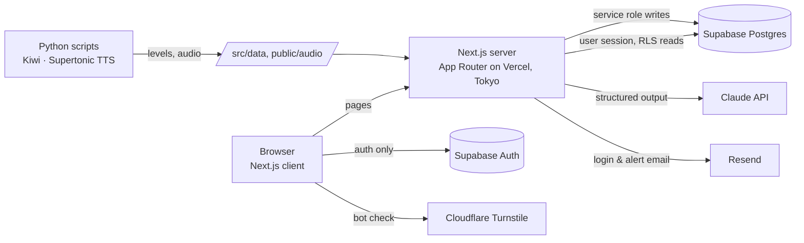

# Write It Slowly · 慢慢寫 · 천천히 쓰기

A Korean writing and listening practice site for Traditional Chinese speakers.
**Always think it through on your own first, then let the AI coach help you fix it, one step at a time.**

🔗 **Live (beta):** https://writeitslowly.com · [中文說明](README.zh-TW.md)

**Video:** https://github.com/user-attachments/assets/d1b27752-d467-4e5b-a527-d6856a65de9c


## Why I built this

It started with something I noticed about myself. I relied on AI tools so much that I couldn't live without them. Whether I was translating or editing something I wrote, they would quickly hand me a reply that looked perfect. It was efficient, but the problem was that I wasn't really thinking, so I wasn't really learning either. That was how the first version of Write It Slowly came about. I hope people who use it (me included) can rediscover the value of thinking and the joy of learning.

## Features

| | |
|---|---|
| **Sentence Workshop** | Users pick a grammar point, read a situation written in Chinese, and write the Korean sentence themselves. The AI coach replies in three layers: what needs fixing → a further clue → a reference sentence. Grammar is grouped into the National Institute of Korean Language levels 1–6 (roughly matching TOPIK levels), so when a sentence includes a word above that level, it shows a small hint under the situation section. |
| **Grammar Map** | The 336 grammar points (levels 1–6) in the National Institute of Korean Language standard curriculum. A square lights up only when users use that grammar correctly in a Korean sentence they wrote themselves. |
| **Dictation** | 116 sentences so far from Korean dramas, music, news, and variety shows, sorted into levels 1–6. Listening mode (users listen, then type what they hear) and typing mode (users test their typing speed). Missed and mistyped syllables are marked, and after users answer, the original source is linked below so users can click through and hear how Korean speakers actually say it. |
| **Review cards** | Users can save any grammar point or sentence they got stuck on and review it later. |
| **My page** | Shows users' progress in charts. |

Beta limits: the Sentence Workshop only covers levels 3 and 4 for now (12 lessons, reviewed and approved by a native Korean speaker). The AI coach has daily limits for each user and for the whole site.

## Architecture



- **All writes go through the server.** Users can only read their own data (row-level security) and cannot add or change it directly. Dictation scores are recalculated on the server.
- **AI usage is counted in the database.** Before every AI call, a database function checks and deducts the count in one step (per user and site-wide). If a call fails, only the server can give the count back.
- **Reference answers stay on the server** until the user's sentence is correct or they have answered three times.
- **Bot protection:** Cloudflare Turnstile on login (verified by Supabase) and on the feedback form (verified by the server).
- **Content Security Policy:** each request gets a one-time nonce, and every response carries security headers.
- **Monitoring:** alert emails when the server hits an error, a private health check that runs once a day on a schedule, and external uptime monitoring.

## Tech stack

Next.js 15 (App Router, TypeScript) · Tailwind CSS 4 · Supabase (Postgres, Auth, RLS) · Anthropic Claude API · Cloudflare Turnstile · Resend · Vercel · Python (Kiwi morphological analyzer, Supertonic TTS)

## Local development

```bash
fnm use            # Node 22
npm install
cp .env.example .env.local   # fill in the values as described in the file
npm run dev
```

Run the SQL files in `supabase/` in order in the Supabase SQL Editor (`schema.sql`, then `002`–`008`).

Environment variables (names only): `NEXT_PUBLIC_SUPABASE_URL`, `NEXT_PUBLIC_SUPABASE_ANON_KEY`, `SUPABASE_SERVICE_ROLE_KEY` (server only), `ANTHROPIC_API_KEY`, `COACH_MODEL`, `COACH_EFFORT`, `DAILY_AI_LIMIT`, `GLOBAL_DAILY_AI_LIMIT`, `NEXT_PUBLIC_TURNSTILE_SITE_KEY`, `TURNSTILE_SECRET_KEY`, `RESEND_API_KEY`, `ALERT_EMAIL_TO`, `ALERT_EMAIL_FROM`, `CRON_SECRET`.

## Data sources & credits

- Word and grammar levels: National Institute of Korean Language, *2017 International Standard Curriculum of Korean Application Study (Phase 4)* word/grammar lists, released under KOGL Type 1 (공공누리 제1유형).
- Dictionary definitions and examples: National Institute of Korean Language, *Basic Korean Dictionary* (한국어기초사전), CC BY-SA 2.0 KR.
- Each dictation sentence quotes only one line from its source and links to the original. The audio is synthesized with Supertone's Supertonic, not taken from the original video. All rights to the original works belong to their owners.
