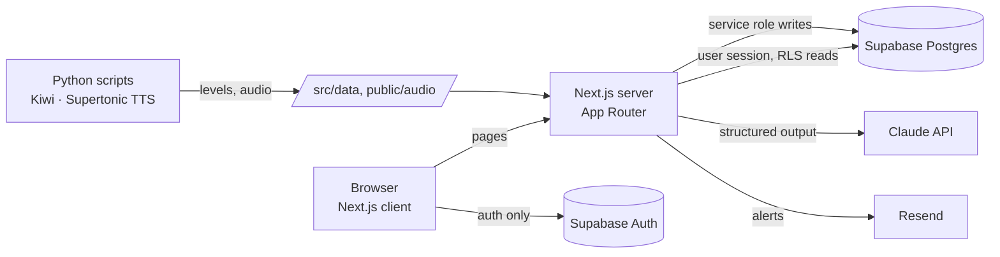

# Write It Slowly · 慢慢寫 · 천천히 쓰기

A Korean writing and listening practice web app for Traditional Chinese speakers.
**Think first, then let the AI coach help you revise.**

> Status: MVP, preparing a closed beta. UI language: Traditional Chinese.

## Why

Most AI writing tools hand you a finished sentence. It feels efficient, but you skip the part that builds skill: retrieving the words yourself. Write It Slowly gives hints in layers and only shows a reference answer after you have tried, and it tracks which grammar you can actually *use*, not just recognize.

## Features

| | |
|---|---|
| **Sentence Workshop** | Pick a grammar point, read a situation in Chinese, write the Korean sentence. The AI coach answers in three server-controlled levels: where the problem is → a clue → the reference sentence. |
| **Grammar Map** | All 336 grammar points (levels 1–6) from the National Institute of Korean Language standard curriculum. A point lights up only when you use it correctly in your own sentence. |
| **Dictation** | 116 sentences from Korean dramas, songs, news, and variety shows, leveled 1–6. Listening mode (hear and type) and typing mode (measure net typing speed). Missing and wrong syllables are marked; the source video or article is linked after you answer. No AI cost. |
| **Review cards** | Sentences you struggled with are saved for review. |
| **My page** | Progress for both practices: grammar growth, accuracy trend, highest level understood, typing speed, sentence book with filters. |

## Architecture



- **All writes go through the server.** Users can read their own rows (row-level security) but cannot insert or update them directly; dictation scores are recomputed on the server.
- **AI usage is metered in the database.** A Postgres function checks and consumes quota atomically (per user and site-wide) before any AI call; failed calls are refunded server-side only.
- **Reference answers stay on the server** until the learner earns them.
- **Content Security Policy** with a per-request nonce; security headers on every response.

## Tech stack

Next.js 15 (App Router, TypeScript) · Tailwind CSS 4 · Supabase (Postgres, Auth, RLS) · Anthropic Claude API (`@anthropic-ai/sdk`, zod structured output) · Python (Kiwi morphological analyzer, Supertonic TTS) · Resend (email)

## Getting started

```bash
fnm use            # Node 22
npm install
cp .env.example .env.local   # fill in the values (see the comments in the file)
npm run dev
```

Run the SQL files in `supabase/` in order (`schema.sql`, then `002`–`008`) in the Supabase SQL Editor.

Environment variables (names only): `NEXT_PUBLIC_SUPABASE_URL`, `NEXT_PUBLIC_SUPABASE_ANON_KEY`, `SUPABASE_SERVICE_ROLE_KEY` (server only), `ANTHROPIC_API_KEY`, `COACH_MODEL`, `COACH_EFFORT`, `DAILY_AI_LIMIT`, `GLOBAL_DAILY_AI_LIMIT`, `RESEND_API_KEY`, `ALERT_EMAIL_TO`, `ALERT_EMAIL_FROM`.

### Data scripts

```bash
python scripts/estimate_levels.py        # level each dictation sentence (Kiwi + NIKL lists)
python scripts/generate_voice_audio.py   # synthesize audio for new sentences
```

## Data sources & credits

- Word and grammar levels: National Institute of Korean Language, *2017 International Standard Curriculum of Korean Application Study (Phase 4)* word/grammar lists, released under KOGL Type 1 (공공누리 제1유형).
- Dictionary definitions and examples: National Institute of Korean Language, *Basic Korean Dictionary* (한국어기초사전), CC BY-SA 2.0 KR.
- Dictation sentences quote a single line from each source with a link to the original; audio is synthesized with Supertone's Supertonic, not taken from the original media. All rights to the original media belong to their owners.

## Project docs

- Product case study: [`docs/portfolio/case-study.md`](docs/portfolio/case-study.md)

---

Built by Kelly, a Taiwanese learner living in Korea, with Claude Code as the AI coding agent.
