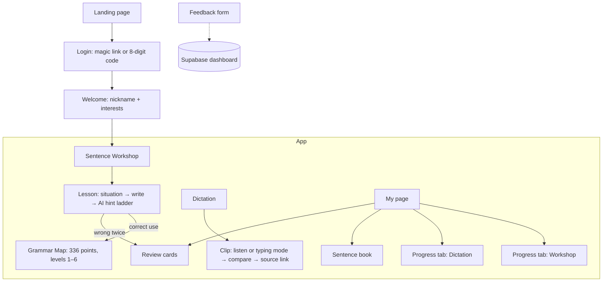
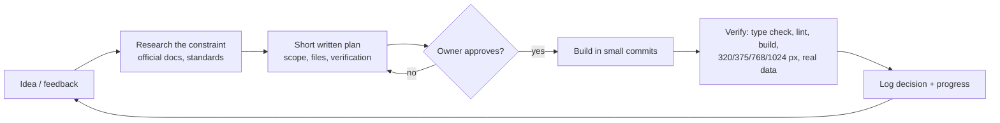
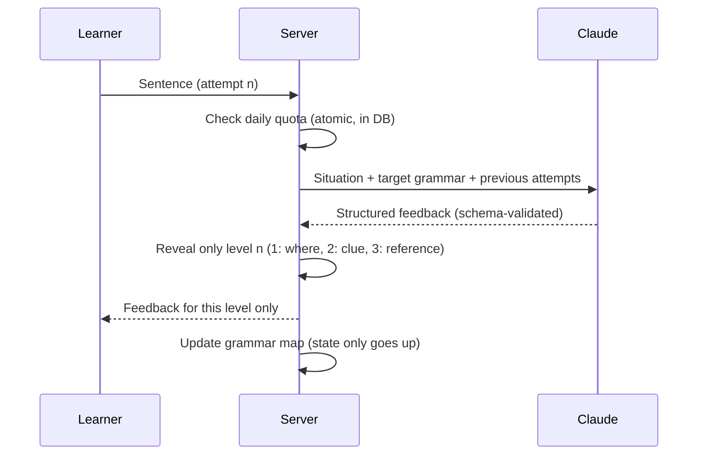

# Write It Slowly (慢慢寫 · 천천히 쓰기) — Product Case Study

> A Korean writing-and-listening practice web app for Traditional Chinese speakers.
> The AI coach gives hints instead of answers, so learners think before they get help.

**Role:** Product owner, UX designer, content curator, and QA. Implementation was done with an AI coding agent (Claude Code) under my direction: I wrote the requirements, made every product decision, reviewed each change in the browser, and ran the verification.
**Timeline:** First commit on Oct 9, 2026; 81 commits in the first 5 days (Oct 9–13).
**Status:** Feature-complete MVP, security-reviewed, preparing a closed beta (not yet public).
**Stack:** Next.js 15 · Supabase (Postgres + Auth + RLS) · Anthropic Claude API · Supertonic TTS · Kiwi (Korean morphological analyzer) · Python data scripts.

---

## 1. Problem Discovery

**Starting point (my own experience).** I reached TOPIK Level 6 through self-study, yet I still turned to AI whenever I had to write formal documents, business emails, or my resume in Korean. The AI's sentences were often slightly awkward, and over time I noticed I had stopped thinking in Korean myself — I outsourced the hardest part of writing.

**What I observed in existing tools** (desk review, not yet validated with users):
| Tool type | What it does well | Gap for my target learner |
|---|---|---|
| General AI chat / grammar checkers | Instantly rewrites the sentence | Gives the answer; no retrieval effort, so the same mistake repeats |
| Flashcard / vocabulary apps | Memorization, streaks | Recognition, not production; streak pressure |
| Exam prep books | TOPIK formats | No feedback on *your* sentence; not built for Chinese speakers' typical errors |

**Target users (hypotheses to test in the beta)**
1. TOPIK IBT candidates whose writing score is stuck and who type Korean slowly.
2. People who want to work in Korea (자기소개서, business email).
3. People who already use Korean at work and want to stop "write in Chinese, then ask AI to translate."
4. K-pop fans who want to write their own fan letters and Bubble messages.

**Problem statement:** Learners can recognize Korean far better than they can produce it, and AI tools that hand over finished sentences widen that gap.

## 2. Product Vision

> "Think first, then let the AI coach help you revise." (先自己想，再讓 AI 陪你改。)

Principles that guided every decision:
1. **Effort before answers** — hints come in layers; the reference sentence appears only after you get it right or try twice.
2. **Authentic Korean** — practice material comes from real Korean sources or is reviewed by a native speaker, never raw AI output.
3. **Progress you can see, without pressure** — a grammar map that lights up only when you *use* a grammar point correctly; no streaks, XP, or nagging notifications.
4. **Built for Traditional Chinese speakers** — UI in Traditional Chinese; hints call out the pairs Chinese speakers mix up (은/는 vs 이/가, -아서 vs -니까).

## 3. Information Architecture

Navigation: 句子工坊 (Workshop) · 聽打練習 (Dictation) · 文法地圖 (Grammar Map) · 我的 ▾ (My page, Review cards).

## 4. Requirements & Planning Process

How it worked in practice:
- Every significant change started as a written plan that I approved before implementation (e.g., an 8-phase roadmap broken out of 14 backlog items).
- Facts were separated from assumptions. Example: before adding a typing-speed grade, we searched for an official Korean typing standard, found the Korea Chamber of Commerce typing test thresholds (150/200/250 keystrokes per minute) in the *Encyclopedia of Korean Culture*, and labeled it as a historical reference rather than a current standard.
- Decisions were logged with dates in a progress file, so later sessions could build on them.

## 5. Prioritization

I used a simple frame for each candidate feature: **learner value × cost to build × risk (content, cost, legal) × evidence**. Examples of real calls:

| Decision | Why |
|---|---|
| Build Dictation **without** AI | Zero marginal cost per use; real sentences from dramas, songs, news, and variety shows match the authenticity principle |
| Use synthetic voice + source link instead of embedding YouTube | YouTube's player rules forbid hiding the video (and on-screen subtitles would give away answers); linking to the timestamp keeps attribution clear |
| Run user testing **before** building the Writing Workshop (IBT / daily / work) | All three need native-written prompts and answers — the slowest resource; feedback should decide which one comes first |
| Defer the TOPIK I/II filter | All 12 current lessons are levels 3–4, so a TOPIK I filter would show nothing |
| Drop "dictation → grammar map" linking | Keeps the map's meaning clear: it shows what you can *produce*, not what you can recognize |
| Security review **before** the beta | Cheaper to fix before real users and real API spend |

## 6. Product & UX Design

**Sentence Workshop — the hint ladder**

- The attempt number is decided on the server, so nobody can jump straight to the answer.
- Reference answers never reach the browser before they are earned.
- Copying an already-revealed answer only counts as "knows it," not "can use it."

**Dictation**
- 116 sentences from real Korean sources (music 51, news 38, variety 14, drama 13), each leveled 1–6 with the National Institute of Korean Language (NIKL) word and grammar lists via the Kiwi morphological analyzer.
- Two modes: **Listening** (hear, type, compare) and **Typing** (see the sentence, measure net speed against the old KCCI typing grades).
- Answer feedback: missing syllables circled in rose; wrong or extra syllables highlighted in the same yellow used across the app, with a legend.
- The card shows genre, level, and the hardest words — not the video title, which could give the answer away.

**My page**
- Two tabs (Workshop / Dictation); each summary tile expands into detail (charts, lists).
- Designed to scale: charts show 30 points at a time with older/newer navigation; lists paginate 10 per page.

## 7. Interaction Design

- **Motion specs written in five parts** — start state, trigger, pivot (transform-origin), ending (duration, easing, spring), and what nearby elements do. Example: the landing-page turtle decelerates over its last 0.3 s with an easing curve whose initial speed matches the walking speed, leans forward ~4°, and springs back.
- **No layout jumps** — hint buttons sit above the hints so new hints grow downward instead of pushing buttons away.
- **Mouse-only hover effects** — no "stuck hover" after a tap on phones.
- **Reduced motion respected** — all animations turn off when the OS setting asks.
- **Dropdown filters** that open on hover with a mouse and on tap with touch, keep URL state, and stay inside the viewport on 320 px screens.

## 8. QA & Iteration

- **Every change verified** with type checking, linting, and a production build, then in a real browser at 320, 375, 768, and 1024 px widths.
- **Automated layout scan** of 15 pages at two widths to catch anything overflowing its card (found and fixed a bar that could draw outside its container).
- **Logic tests** for answer comparison (missing, wrong, sandhi spelling errors, extra, spacing) and for safe redirects.
- **Content QA** — machine transcripts of 41 videos yielded only 7 usable lines on the first pass; I re-checked the rest against the original videos and the official lyrics, fixed timestamps, and rejected auto-translated lyrics (songs originally sung in English or Chinese), because they are not what the singers actually sing.
- **Native review loop** — the 49 workshop sentences were exported to a Korean-only review document for a native speaker.

## 9. Security & Reliability Review

A structured review before the beta found 9 issues; the important ones were fixed and verified against the live database:
| Severity | Issue | Fix |
|---|---|---|
| High | AI quota could be bypassed by refunding usage records | Usage rows hidden from users; refunds server-only |
| Medium | Open redirect after code login via a tab character in `next` | Reject whitespace/control characters and verify same origin |
| Low → fixed | Users could write their own scores directly | All writes go through the server (service role); dictation scores recomputed server-side |
| Low → fixed | No script restrictions | Nonce-based Content Security Policy |

Also in place: row-level security on every table, per-user and global AI limits, error-alert emails, a health endpoint, and a daily keep-alive job.

## 10. Results so far & Next Steps

**Shipped:** Sentence Workshop (12 lessons), Grammar Map (336 points), Dictation (116 sentences, 2 modes), review cards, progress dashboards, landing page.
**Next:** closed beta with 5–10 target learners → measure task completion, return visits, and where people stop → decide which Writing Workshop track (TOPIK IBT, work, daily life) to build first.

**What I learned**
- AI coding agents make building fast; the bottleneck moves to **judgment**: what to build, what is true, and what is good enough to ship.
- Authentic content is a product feature, not an afterthought — and it is the slowest part of the pipeline.
- "Demo-ready" is not "launch-ready": data access, keys, abuse limits, and monitoring only show up when you look for them.
